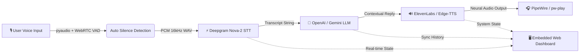

# JARVIS: Personal AI Voice Assistant

<p align="center">
  
  
  
  
  
</p>

An intelligent, low-latency conversational AI voice assistant written in Python. Integrates hardware-accelerated voice activity detection (VAD), cloud-based speech-to-text (Deepgram Nova-2), generative reasoning (OpenAI/Gemini), and neural speech synthesis (ElevenLabs / Edge-TTS) paired with a real-time reactive web dashboard.

---

## 🏛️ Architecture & Dataflow



---

## ✨ Features

- **⚡ Sub-Second Latency Pipeline:** Uses Deepgram's Nova-2 transcription model for near-instant speech recognition.
- **🎙️ Automatic Voice Activity Detection:** Automatically starts recording when you speak and stops when you pause—no buttons required.
- **🔊 Multi-Engine Neural TTS:** Seamlessly supports **ElevenLabs** for cloned voices with an automatic, zero-cost fallback to **Edge-TTS** (no API key required).
- **🖥️ Zero-Dependency Web Dashboard:** Beautiful modern dark-mode dashboard providing real-time chat history and state monitoring.
- **🐧 Arch Linux & PipeWire Optimized:** Native Linux audio backend detection with automatic fallback across `pw-play`, `paplay`, and `ffplay`.
- **🛡️ Secure Secret Management:** Strict `.gitignore` configuration ensuring your credentials and private audio recordings never leak to GitHub.

---

## 📂 Project Structure

```
jarvis-voice-assistant/
├── .github/
│   └── workflows/ci.yml         # GitHub Actions automated CI
├── src/
│   ├── config.py                # Strongly-typed configuration
│   ├── logger.py                # Colorized structured logger
│   ├── audio/
│   │   ├── recorder.py          # VAD microphone stream engine
│   │   └── player.py            # Low-latency audio player
│   ├── services/
│   │   ├── stt.py               # Deepgram speech-to-text service
│   │   ├── llm.py               # Pluggable LLM interface (OpenAI / Fallback)
│   │   └── tts.py               # Speech synthesis (ElevenLabs / Edge-TTS)
│   ├── core/
│   │   ├── state.py             # Event-driven State Machine
│   │   └── assistant.py         # Main conversation orchestrator
│   └── web/
│       └── server.py            # High-performance HTTP/API dashboard
├── tests/
│   └── test_audio.py            # Unit tests
├── .env.example                 # Sanitized environment template
├── .gitignore                   # Security exclusion rules
├── pyproject.toml               # PEP 517 standard package definition
├── requirements.txt             # Pip dependency manifest
└── main.py                      # Unified CLI entry point
```

---

## 🚀 Getting Started

### 1. Prerequisites (Arch Linux)
Ensure development headers and audio servers are present:
```bash
sudo pacman -S --needed portaudio ffmpeg base-devel
```

### 2. Installation
```bash
git clone https://github.com/your-username/jarvis-voice-assistant.git
cd jarvis-voice-assistant

python -m venv venv
source venv/bin/activate
pip install -r requirements.txt
```

### 3. Configuration
Copy the template and add your credentials:
```bash
cp .env.example .env
nano .env
```

```ini
DEEPGRAM_API_KEY=your_deepgram_api_key_here
OPENAI_API_KEY=your_openai_api_key_here
ELEVENLABS_API_KEY=your_elevenlabs_api_key_here
```

---

## 🎮 Usage

### Run Assistant & Web Dashboard (Recommended)
This starts the voice assistant and automatically spins up the dashboard at `http://localhost:5000`:
```bash
python main.py
```

### Command-Line Options
```bash
# Run microphone diagnostic test:
python main.py --test-mic

# Run only the web dashboard:
python main.py --web-only

# Run without the web dashboard:
python main.py --no-web
```

---

## 🧪 Testing

Run automated tests via `pytest`:
```bash
pytest tests/
```

---

## 📜 License
Distributed under the MIT License. See `LICENSE` for more information.
