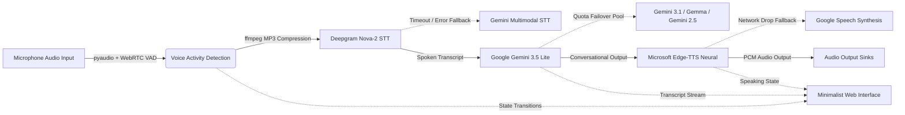

# Veda: Conversational AI Voice Assistant and Companion

<p align="center">
  
  
  
  
  
  
</p>

> Here to listen, ready to help.

Veda is a low-latency, conversational AI voice assistant and companion built for Linux, macOS, and POSIX-compliant environments. Engineered with automated multi-model failover, resilient cloud fallbacks, pre-upload audio compression, and an ultra-minimalist dark web interface, Veda delivers natural, empathetic dialogue and intelligent problem-solving.

---

## System Architecture



---

## Core Engineering Features

### Resilient Multi-Tier LLM Orchestration
- Powered primarily by Google Gemini (`gemini-3.5-flash-lite`) via Google AI Studio free tier.
- Automatic failover pool transitions (`gemini-3.5-flash-lite` -> `gemini-3.1-flash-lite` -> `gemma-4-26b-a4b-it` -> `gemini-2.5-flash`) when encountering HTTP 429 quota exhaustion or HTTP 503 service unavailability.
- Pre-synthesis text sanitization strips markdown syntax characters to maintain clear, lifelike neural cadence.

### Pre-Upload Audio Compression
- Audio frames captured by PyAudio are compressed from 16kHz raw PCM WAV into 32kbps MP3 via `ffmpeg` prior to cloud transmission.
- Reduces upload payload volume by over 85%, eliminating write timeouts and slow upload errors on unstable networks.

### Dual-Engine Speech-to-Text (STT)
- Primary transcription via Deepgram Nova-2 with a strict 5-second network deadline.
- Automatic secondary fallback routes compressed audio to Google Gemini Multimodal Audio transcription in the event of upstream network disruption.

### Fault-Tolerant Neural Speech Synthesis (TTS)
- Primary voice generation via Microsoft Edge-TTS neural engine (`en-US-ChristopherNeural`), converted directly to PCM WAV for native Linux audio servers.
- Exponential backoff retry mechanism (3 attempts) handles transient DNS or transport drops.
- Secondary fallback to Google Text-to-Speech (`gTTS`) ensures continuous voice response capability without system termination.

### Native Linux and Cross-Platform Audio Routing
- Dedicated audio sink dispatcher automatically detects and prioritizes PipeWire (`pw-play`), PulseAudio (`paplay`), macOS native (`afplay`), ALSA (`aplay`), or FFplay (`ffplay`).
- Automatic detection of 16kHz audio input sources with native Bluetooth headset routing.

### Ultra-Minimalist Web Interface
- Zero-dependency embedded web server running locally on port 5000.
- Dark theme interface with real-time state visualization (Live, Listening, Thinking, Speaking).
- Interactive input card with typed message submission, conversation stream, and quick action cards:
  - Talk & Vent: Share what is on your mind
  - Find Solutions: Answers, ideas & advice
  - Ask Anything: Code, questions & facts

---

## Directory Structure

```
jarvis-voice-assistant/
├── .github/
│   └── workflows/
│       └── ci.yml               # Automated CI workflow
├── src/
│   ├── config.py                # Strongly-typed dataclass configuration
│   ├── logger.py                # Colorized structured logging module
│   ├── audio/
│   │   ├── recorder.py          # VAD microphone stream engine with auto-detection
│   │   └── player.py            # Audio player dispatcher (pw-play, paplay, ffplay)
│   ├── services/
│   │   ├── stt.py               # Deepgram Nova-2 STT with MP3 compression & Gemini fallback
│   │   ├── llm.py               # Gemini multi-model failover pool & OpenAI integration
│   │   └── tts.py               # Dual-engine TTS (Edge-TTS & Google TTS)
│   ├── core/
│   │   ├── state.py             # Event-driven StateManager (Idle, Listening, Processing, Speaking)
│   │   └── assistant.py         # Primary conversation coordinator
│   └── web/
│       └── server.py            # Embedded minimalist web interface and API server
├── tests/
│   ├── test_audio.py            # Audio configuration and state tests
│   └── test_core.py             # Core architecture, personality, and fallback tests
├── .env.example                 # Environment variable template
├── .gitignore                   # Git exclusion rules
├── pyproject.toml               # PEP 517 package configuration
├── requirements.txt             # Python dependency manifest
└── main.py                      # Application entry point with self-healing venv launcher
```

---

## Getting Started

### 1. System Dependencies

#### Arch Linux / Manjaro:
```bash
sudo pacman -S --needed portaudio ffmpeg base-devel pipewire
```

#### Ubuntu / Debian / Linux Mint:
```bash
sudo apt update && sudo apt install -y portaudio19-dev ffmpeg build-essential
```

#### Fedora / RHEL:
```bash
sudo dnf install -y portaudio-devel ffmpeg gcc
```

#### macOS (via Homebrew):
```bash
brew install portaudio ffmpeg
```

### 2. Python Environment Setup

Clone the repository and install dependencies inside a dedicated virtual environment:
```bash
git clone https://github.com/your-username/jarvis-voice-assistant.git
cd jarvis-voice-assistant

python -m venv venv
source venv/bin/activate
pip install -r requirements.txt
```

### 3. Environment Configuration

Copy the template configuration:
```bash
cp .env.example .env
```

Edit `.env` with your API credentials:
```ini
# Deepgram (Speech-to-Text): https://console.deepgram.com
DEEPGRAM_API_KEY=your_deepgram_api_key_here

# Google Gemini (Primary LLM - Free tier available): https://aistudio.google.com/apikey
GEMINI_API_KEY=your_gemini_api_key_here
GEMINI_MODEL=gemini-3.5-flash-lite

# Optional fallbacks
OPENAI_API_KEY=
ELEVENLABS_API_KEY=

# Server configuration
PORT=5000
HOST=0.0.0.0
```

---

## Execution and CLI Options

### Standard Mode
Launches the voice assistant and automatically opens the web interface in your default browser:
```bash
python main.py
```

### Command-Line Arguments
```bash
# Run voice assistant and web server without launching a browser window:
python main.py --no-browser

# Run only the web interface without microphone initialization:
python main.py --web-only

# Run headlessly in terminal without starting the web server:
python main.py --no-web

# Execute a standalone microphone hardware and VAD diagnostic test:
python main.py --test-mic
```

---

## Quality Assurance and Testing

Execute the test suite using `pytest`:
```bash
pytest tests/
```

Run linting checks:
```bash
flake8 src/ tests/
```

---

## Security and Privacy Notice

- API keys and environment configurations are excluded from version control via `.gitignore`.
- Recorded audio files (`recording.wav`, `recording.mp3`) and synthesized speech files are stored in `audio/` and excluded from repository commits.
- No personal user audio is retained on external servers beyond the lifetime of individual transcription and synthesis API requests.

---

## License

Distributed under the terms of the MIT License. See `LICENSE` for details.
