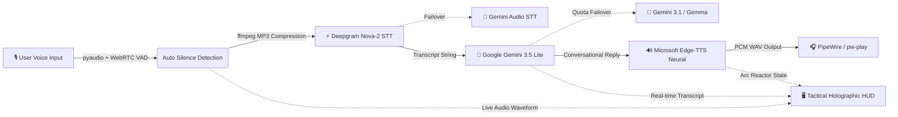

# J.A.R.V.I.S.: Tactical AI Voice Assistant & Holographic HUD

<p align="center">
  
  
  
  
  
  
</p>

An intelligent, low-latency conversational AI voice assistant inspired by Tony Stark's J.A.R.V.I.S., running locally on Arch Linux with a zero-dependency futuristic holographic web HUD.

---

## 🏛️ Architecture & Dataflow



---

## ✨ Features

- **⚡ Blazing Fast Conversational Loop:** Generates intelligent, charismatic voice responses in ~1-2 seconds end-to-end.
- **🎙️ Automatic Voice Activity Detection (VAD):** Listens continuously and triggers automatically when you speak and pause—no push-to-talk buttons.
- **📦 Pre-Upload Audio Compression:** Automatically compresses raw audio to 32kbps MP3 via ffmpeg before sending to cloud STT, reducing payload size by 85% and preventing slow upload timeouts.
- **🛡️ Multi-Model Quota Failover:** Automatically switches between free models (`gemini-3.5-flash-lite` → `gemini-3.1-flash-lite` → `gemma-4-26b-a4b-it`) if daily limits or demand spikes occur.
- **🔊 Zero-Cost High-Fidelity TTS:** Uses Microsoft Edge Neural voices (`en-US-ChristopherNeural`) with automatic WAV PCM conversion for native PipeWire audio servers.
- **🖥️ Stark Industries Arc Reactor HUD:** Embedded sci-fi tactical web interface with rotating dual arc rings, audio equalizer bars, live status transitions, and real-time comms logging.
- **🐧 Native Arch Linux & PipeWire Optimization:** Auto-detects 16kHz PipeWire audio sinks/sources and supports seamless Bluetooth headset routing.

---

## 📂 Project Structure

```
jarvis-voice-assistant/
├── .github/
│   └── workflows/ci.yml         # GitHub Actions automated CI
├── src/
│   ├── config.py                # Strongly-typed configuration
│   ├── logger.py                # Colorized structured logger
│   ├── audio/
│   │   ├── recorder.py          # VAD microphone stream engine (PipeWire auto-detect)
│   │   └── player.py            # Low-latency audio player (pw-play / paplay / ffplay)
│   ├── services/
│   │   ├── stt.py               # Deepgram Nova-2 STT with MP3 compression & Gemini fallback
│   │   ├── llm.py               # Multi-model Gemini failover & OpenAI integration
│   │   └── tts.py               # Speech synthesis (Edge-TTS / ElevenLabs)
│   ├── core/
│   │   ├── state.py             # Event-driven State Machine (Idle, Listening, Processing, Speaking)
│   │   └── assistant.py         # Main conversation orchestrator
│   └── web/
│       └── server.py            # Zero-dependency Arc Reactor Tactical HUD server
├── tests/
│   └── test_audio.py            # Unit tests
├── .env.example                 # Sanitized environment template
├── .gitignore                   # Security exclusion rules
├── pyproject.toml               # PEP 517 standard package definition
├── requirements.txt             # Pip dependency manifest
└── main.py                      # Unified CLI entry point
```

---

## 🚀 Getting Started

### 1. Prerequisites by Operating System

#### **Arch Linux / Manjaro:**
```bash
sudo pacman -S --needed portaudio ffmpeg base-devel pipewire
```

#### **Ubuntu / Debian / Linux Mint / Pop!_OS:**
```bash
sudo apt update && sudo apt install -y portaudio19-dev ffmpeg build-essential
```

#### **Fedora / RHEL:**
```bash
sudo dnf install -y portaudio-devel ffmpeg gcc
```

#### **macOS (via Homebrew):**
```bash
brew install portaudio ffmpeg
```

### 2. Installation
```bash
git clone https://github.com/your-username/jarvis-voice-assistant.git
cd jarvis-voice-assistant

python -m venv venv
source venv/bin/activate
pip install -r requirements.txt
```

### 3. Configuration
Copy the template and configure your keys:
```bash
cp .env.example .env
nano .env
```

```ini
# Deepgram (Free speech recognition): https://console.deepgram.com
DEEPGRAM_API_KEY=your_deepgram_api_key_here

# Google Gemini (Free AI Studio key, no credit card required): https://aistudio.google.com/apikey
GEMINI_API_KEY=your_gemini_api_key_here
GEMINI_MODEL=gemini-3.5-flash-lite

# Optional Fallbacks
OPENAI_API_KEY=
ELEVENLABS_API_KEY=
```

---

## 🎮 Usage

### Run Voice Assistant & Launch Screen
This launches JARVIS and automatically pops open the Tactical Arc Reactor HUD in your browser:
```bash
python main.py
```

### Command-Line Options
```bash
# Run without auto-opening the browser:
python main.py --no-browser

# Run only the Tactical Web HUD:
python main.py --web-only

# Run headlessly in terminal without web dashboard:
python main.py --no-web

# Run microphone diagnostic test:
python main.py --test-mic
```

---

## 🧪 Testing

Run automated tests via `pytest`:
```bash
pytest tests/
```

---

## 📜 License
Distributed under the MIT License. See `LICENSE` for more information.

---

## 🧪 Testing

Run automated tests via `pytest`:
```bash
pytest tests/
```

---

## 📜 License
Distributed under the MIT License. See `LICENSE` for more information.
